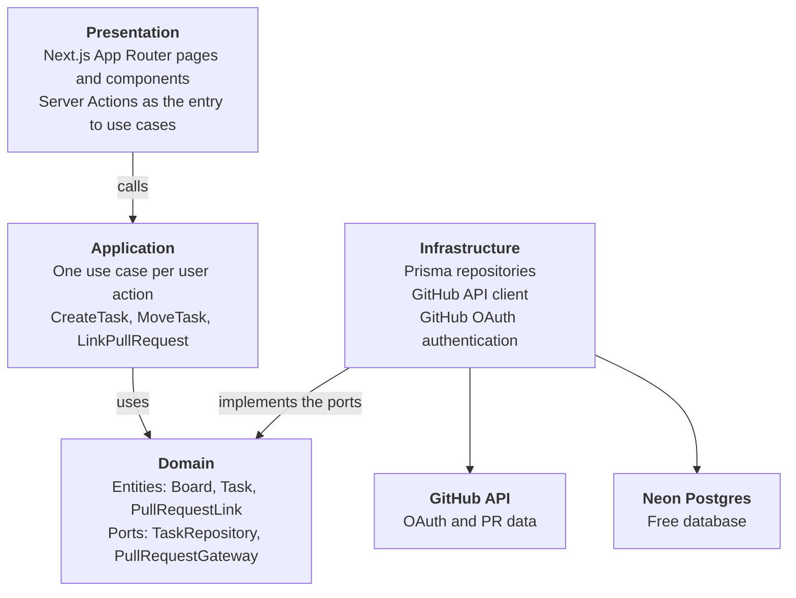

# DevFlow AI — v0.1 Requirements

## Vision

v0.1 delivers a kanban board where every task is linked to its GitHub pull request, deployed with CI/CD. The AI agents arrive in v0.2.

**The problem.** In a small team, the task lives on a board and the code lives on GitHub. To know whether a task already has a PR, whether it is in review or already merged, you have to jump between two tools.

**The proposal.** A board where every task shows the real state of its PR, without leaving the app. On top of that foundation, starting in v0.2, agents review the code, suggest tests and write documentation.

**What the project demonstrates.** A complete end-to-end product: OAuth authentication, database, API, integration with an external service, layered architecture, testing, CI/CD and accessibility.

## Users

v0.1 serves two kinds of users: people working with their own repositories and people visiting the project from the portfolio.

| User | Who they are | What they need |
| --- | --- | --- |
| Developer | A developer on a small team or personal project, with repositories on GitHub | Organize tasks and see the state of their PRs in one place |
| Visitor | A recruiter or developer arriving from the portfolio | Try the board without an account and without connecting repositories |

The visitor uses **demo mode**: sample data, no sign-in and no writes to the real database.

## v0.1 scope

v0.1 consists of 8 user stories. Each one is done only when it meets all of its acceptance criteria.

### US-01 · Sign in with GitHub

As a developer, I want to sign in with my GitHub account so I don't need another password.

- A "Continue with GitHub" button starts the OAuth flow.
- When I come back, I see my board with my GitHub name and avatar.
- If I cancel on GitHub, I return to the home screen with a clear message.
- I can sign out from the user menu.
- Board routes redirect to the home screen when there is no session.

### US-02 · Have my own board

As a developer, I want a board ready when I sign in so I can start without any setup.

- The first time I sign in, my board is created automatically.
- The board has 4 fixed columns: To do, In progress, In review and Done.
- When there are no tasks, each column shows an empty state that invites me to create one.

### US-03 · Create, edit and delete tasks

As a developer, I want to manage my tasks to reflect the real work.

- I create a task with a title (required, up to 120 characters) and a description (optional).
- A new task appears in To do.
- I edit the title and description from the task detail.
- Deleting asks for confirmation first.
- Validation errors are shown next to the field and announced to screen readers.

### US-04 · Move tasks between columns

As a developer, I want to move a task to another column to show its progress.

- I move tasks by dragging with a mouse or a finger.
- I can also move them with the keyboard only: select, move with the arrow keys, drop with Enter or Space, cancel with Escape.
- Screen readers announce every move ("Task moved to In review, position 2 of 3").
- The order within a column is saved.
- The change shows instantly and, if saving fails, the task returns to its place with a notice.

### US-05 · Link a task to its PR

As a developer, I want to link a task to its pull request to keep everything in one place.

- In the task detail, I paste the URL of a GitHub pull request.
- The app validates that the URL has the format of a PR and that the PR exists and is accessible with my account.
- If it is not valid, I see why (wrong format, PR not found or no access).
- In v0.1 a task has at most one linked PR.
- I can unlink the PR.

### US-06 · See the PR state on the card

As a developer, I want to see the PR state without opening GitHub.

- The card shows the repository, number and state of the PR: draft, open, merged or closed.
- The state is shown with text and an icon, not only with color.
- The state is refreshed when the board opens.
- A link opens the PR on GitHub in a new tab.

### US-07 · Try demo mode

As a visitor, I want to try the board without an account to understand the project in a minute.

- A "View demo" button on the home screen opens a board with sample tasks and PRs.
- I can move tasks and open their detail; changes are not saved.
- A visible notice says it is a demo.
- Demo mode never calls the GitHub API or writes to the database.

### US-08 · Continuous integration and deployment

As the project developer, I want every change to be verified and deployed automatically so production never breaks.

- Every PR to main runs lint, typecheck, tests and build on GitHub Actions.
- A PR with failing CI is never merged.
- Every merge to main deploys the app automatically.
- The public URL is listed in the README.

## Out of scope

Nothing on this list is discarded; it just does not ship in v0.1. The agents are the core of the product and arrive in v0.2 and v0.3, on top of the foundation v0.1 builds. If something from this list comes up during development, it is filed as an issue for its version.

| Feature | Planned version |
| --- | --- |
| Code review agent | v0.2 |
| Test and documentation agents | v0.3 |
| Metrics dashboard | v0.3 |
| Own MCP server | v0.4 |
| Teams, invitations and roles | Not scheduled |
| Multiple boards or custom columns | Not scheduled |
| Multiple PRs per task | Not scheduled |
| Real-time updates (GitHub webhooks) | Not scheduled |
| Labels, due dates and assignees | Not scheduled |

## Non-functional requirements

Five requirements apply to every user story. The numeric targets are an initial proposal and will be reviewed after the first deployment.

| Requirement | Target | How it is verified |
| --- | --- | --- |
| Accessibility | WCAG 2.2 AA; everything works with the keyboard; focus always visible | Lighthouse, eslint-plugin-jsx-a11y and manual testing with VoiceOver |
| Performance | Mobile Lighthouse score of 90 or higher on the home and board pages | Lighthouse on the deployed URL |
| Security | Secrets only in environment variables; every query filters by the session user; minimal GitHub permissions | Review on every PR and cross-user access tests |
| Cost | 0 USD per month: free tiers only | Billing review for each service |
| Quality | Lint and typecheck with no errors; tests for use cases and key components; one end-to-end test of the main flow | CI on every PR |

The interface is responsive from 360 px and uses its own design system, with the same palette as the portfolio.

## Initial data model

Four domain entities are enough for v0.1. Columns are not a table: they are a fixed task status, because they cannot be customized in v0.1.

| Entity | Main fields | Relationship |
| --- | --- | --- |
| User | id, githubId, login, name, avatarUrl | Has one Board |
| Board | id, userId, name, createdAt | Belongs to a User; has many Tasks |
| Task | id, boardId, title, description, status (TODO, IN_PROGRESS, IN_REVIEW, DONE), position, createdAt, updatedAt | Belongs to a Board; has zero or one PullRequestLink |
| PullRequestLink | id, taskId, owner, repo, number, url, title, state (DRAFT, OPEN, MERGED, CLOSED), syncedAt | Belongs to a Task |

Session and OAuth account tables are defined by the authentication library through its Prisma adapter; they are not designed by hand. PullRequestLink stores a copy of the PR state so the board renders without calling GitHub for every card.

## Stack and architecture

The stack reuses the portfolio's foundation and adds what is needed for data, authentication and deployment, all on free tiers.

| Piece | Choice | Why |
| --- | --- | --- |
| Framework | Next.js 16 (App Router) and TypeScript | Same foundation as the portfolio |
| Styling | Tailwind CSS and its own design system | Same palette as the portfolio |
| Database | Neon (Postgres) with Prisma | Free and no server to maintain |
| Authentication | GitHub OAuth | Users already have an account and their PRs live there |
| Forms | React Hook Form and Zod | Typed validation |
| Kanban | dnd-kit | Drag and drop accessible with keyboard and screen readers |
| Testing | Jest, Testing Library and Playwright | Unit, component and end-to-end tests |
| CI/CD | GitHub Actions | Free for public repositories |
| AI (from v0.2) | Gemini API through Google AI Studio | Free tier |

The arrows point toward the domain: business rules know nothing about Prisma or GitHub. That is why, in v0.2, the AI provider can be swapped by changing only the infrastructure layer.

## Open decisions

Five decisions remain open. Each one has a recommendation and the moment it should be settled.

- [ ] **Authentication library.** Recommendation: choose between Auth.js and Better Auth based on which has stable Next.js 16 support and a Prisma adapter. Settle before the sign-in issue.
- [ ] **GitHub permissions.** Recommendation: public repositories only in v0.1, without requesting the `repo` scope. It asks users for less access and fits the rule of never sending private code to the AI in v0.2. Settle before the sign-in issue.
- [ ] **Deployment: Vercel or Cloud Run.** Recommendation: Vercel while building v0.1, since it does not require a credit card. When v0.1 is done, decide whether to move to Cloud Run; only `deploy.yml` changes.
- [ ] **Demo mode data.** Recommendation: a sample data file inside the repository, with no database. Settle in the demo mode issue.
- [ ] **Design system.** Recommendation: define colors, typography, spacing and base components before the first screen. It is the next document after this one.

## Issue plan

v0.1 is split into 10 issues, each with its own branch and PR. The order puts the foundation first (CI, design, data, deployment) so every feature ships verified and published.

1. **Scaffold Next.js app with CI** (#1, done). Part of US-08.
2. **Design system: tokens and base components.** Colors, typography, spacing, button, text field, card.
3. **Database setup with Prisma and Neon.** Initial schema from the data model.
4. **Deploy pipeline.** Automatic deployment on merge to main. Part of US-08.
5. **Sign in with GitHub.** US-01.
6. **Board with fixed columns and task CRUD.** US-02 and US-03.
7. **Accessible drag and drop.** US-04.
8. **Link tasks to pull requests.** US-05 and US-06.
9. **Demo mode.** US-07.
10. **End-to-end test and v0.1 release.** End-to-end test of the main flow, tests in CI, public URL in the README and the `v0.1.0` tag. Completes US-08.

Unit tests are written inside each issue starting with issue 5; the test step joins the CI with the first one.
